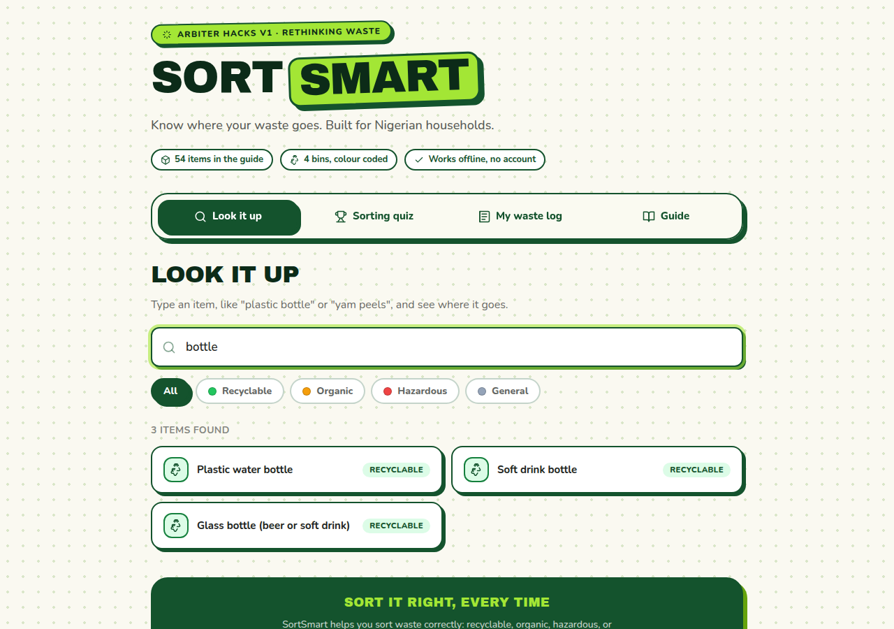
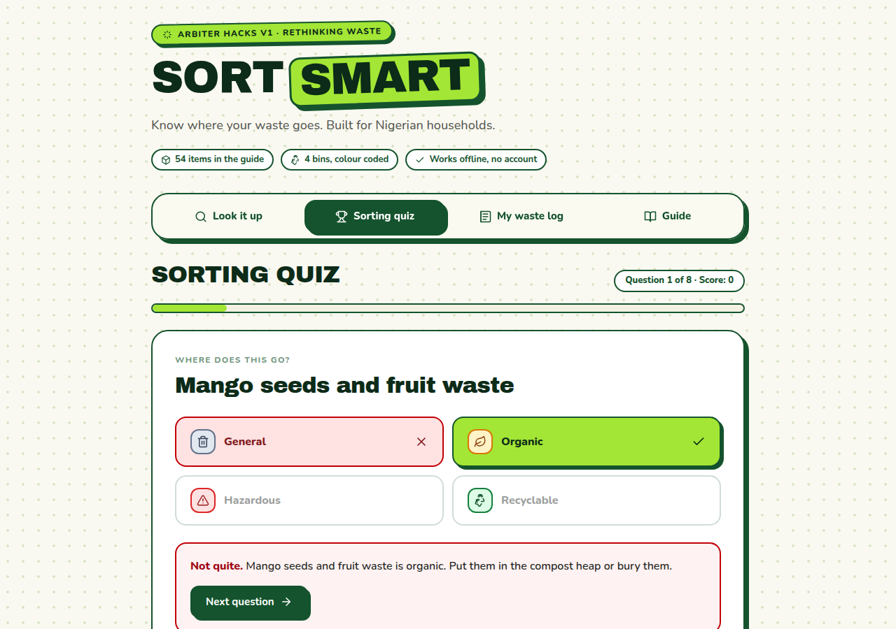
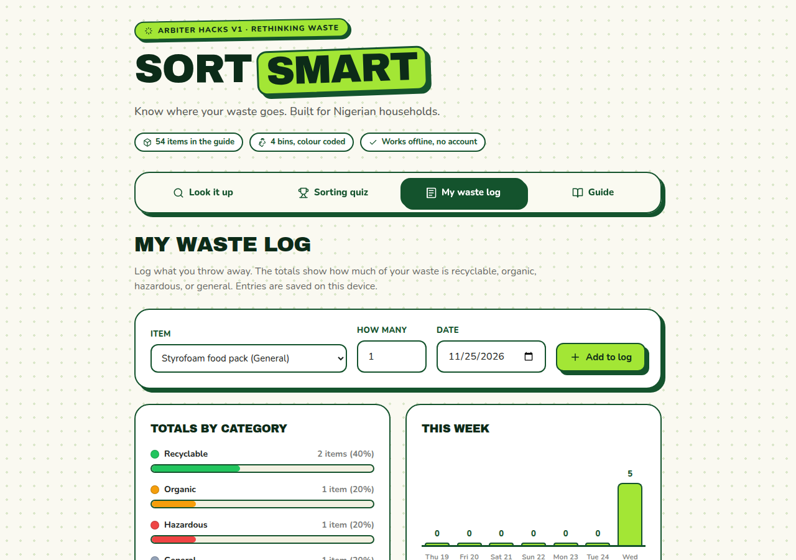
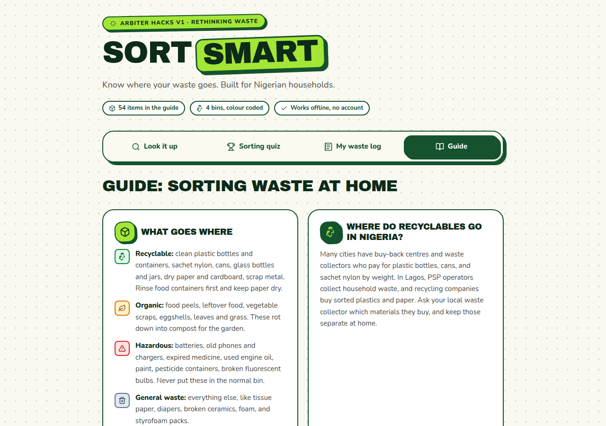

# SortSmart

A waste sorting helper for Nigerian households. Search any household item and
it tells you where it goes: recyclable, organic, hazardous, or general waste.
It also has a short quiz to teach sorting, a log so you can track what you
throw away, and a plain guide on where recyclables actually go in Nigeria.

Built for Arbiter Hacks V1, Theme Track (Rethinking Waste).

## The problem

Most homes in Nigeria throw everything into one bag: plastic bottles, yam
peels, old batteries, sachet nylon, broken ceramics. Mixed waste is hard to
recycle, so most of it ends up in open dumps or burned. Batteries and other
dangerous items leak chemicals into the soil. Gutters get blocked with nylon
and bottles, which makes flooding worse.

The people who collect and buy recyclables (buy-back centres, waste
collectors, scrap dealers) can only take clean, sorted material. If a
household knows what to keep separate, more of its waste can be sold or
composted instead of dumped.

## What it does

1. **Look it up.** Type an item like "plastic bottle", "yam peels", "battery"
   or "sachet water bag" and get its category, what to do with it, and why.
   The database has 54 common Nigerian household items. You can also filter
   by category.
2. **Sorting quiz.** Eight questions, "which bin does this go in?", with a
   score at the end and an explanation after every answer.
3. **My waste log.** Log what you threw away, see totals by category with
   percentages, and a bar chart of the last 7 days. Entries are saved in the
   browser, so they are still there when you come back.
4. **Guide.** Plain advice: what goes where, where recyclables go in Nigeria
   (buy-back centres, PSP operators, waste collectors), what never to burn or
   dump, how to start composting at home, and how to sort with just three
   bags or buckets.

## How to run it

You need Node.js installed.

```bash
npm install
npm run dev
```

Then open the address it prints (usually http://localhost:5173).

To build it for production:

```bash
npm run build
npm run preview
```

## How I built it

- React with Vite, plain JavaScript. No backend and no database server.
- The item database is a JavaScript file (`src/data/items.js`) with the
  category, disposal instructions, and a short reason for each item.
  Categories follow what is realistic in Nigeria: "recyclable" means a
  buy-back centre, waste collector, or scrap dealer will actually take it.
- The waste log uses the browser's localStorage, so it works offline after
  the first load and needs no account.
- The weekly chart is plain HTML and CSS, no chart library.

## Screenshots






## The waste problem I targeted (Theme Track)

The specific problem is that Nigerian households do not sort waste at home,
mostly because nobody has taught them what goes where, so recyclable material
gets mixed with food waste and dangerous items and ends up dumped or burned.
SortSmart targets that first step: knowing which bin an item belongs in, and
seeing your own waste pattern through the log. I would measure whether it
worked by checking, after some weeks of use, whether the share of recyclable
and organic waste in a household's log goes up while the general waste share
goes down, and whether quiz scores improve on a second try.

## What I would do next

- Add a photo option so you can take a picture of an item instead of typing.
- Add more items, including ones people ask about but are not in the list yet.
- Show the nearest buy-back centres by area, starting with Lagos and Abuja.
- Make the guide available in Nigerian Pidgin, Hausa, Yoruba, and Igbo so
  more people can use it.
- Turn it into a small PWA so it installs on a phone and works offline.

## License

MIT. Free to use and improve.
